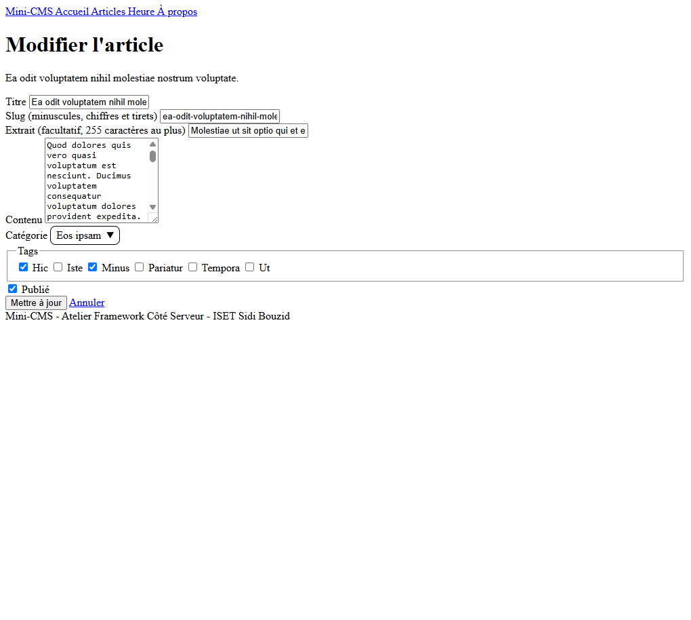
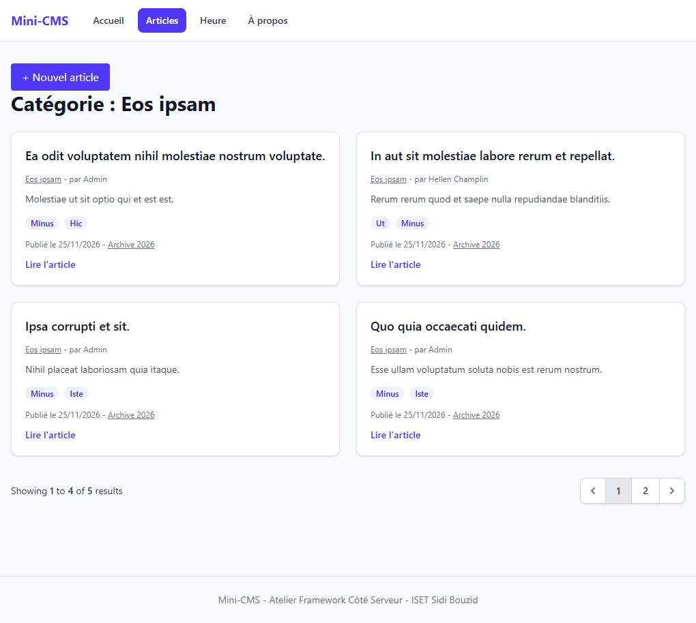
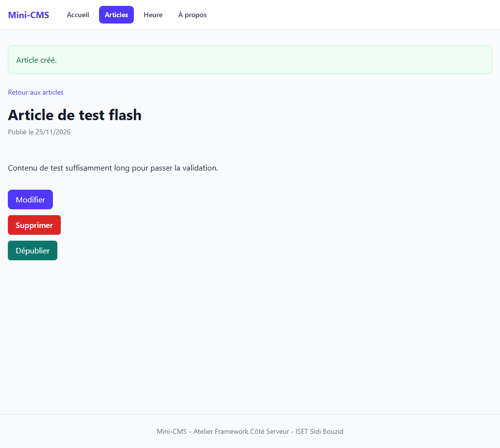
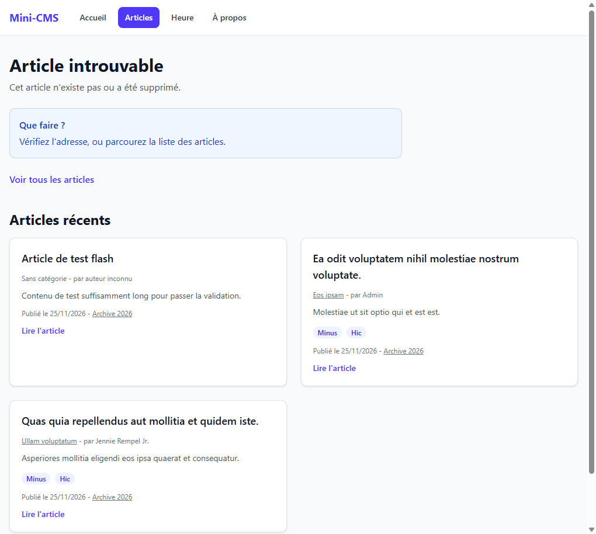
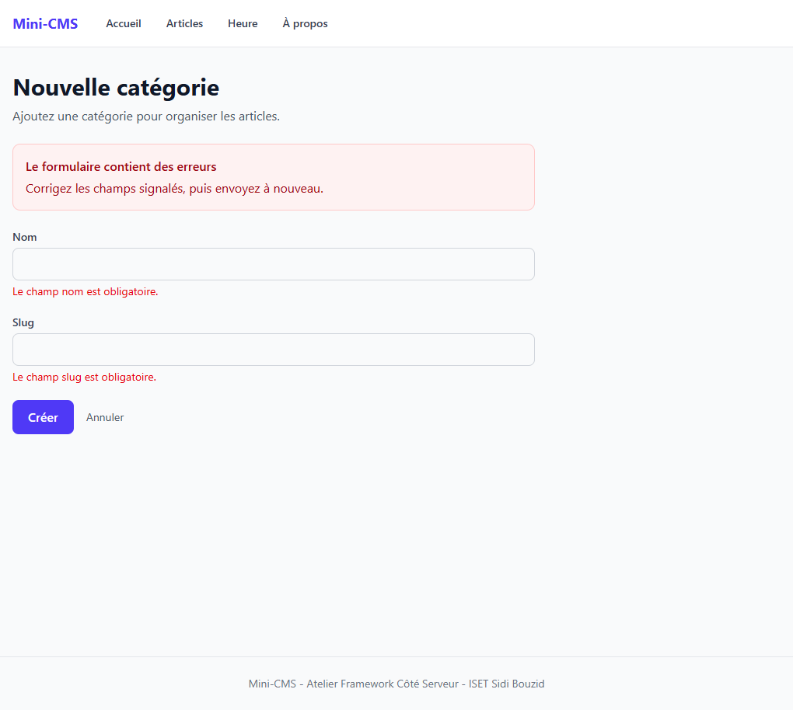
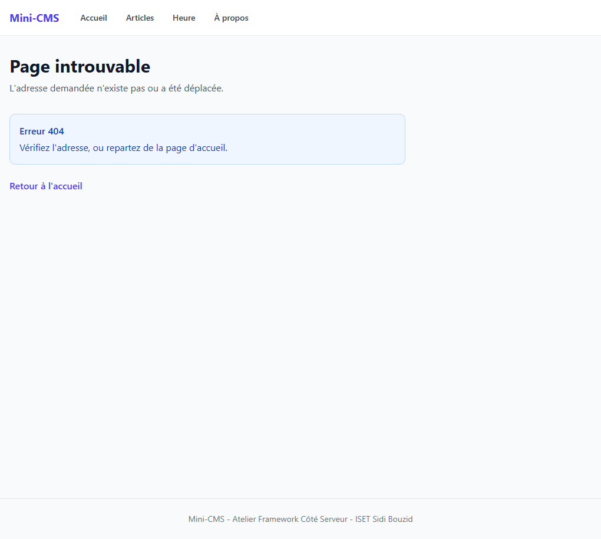
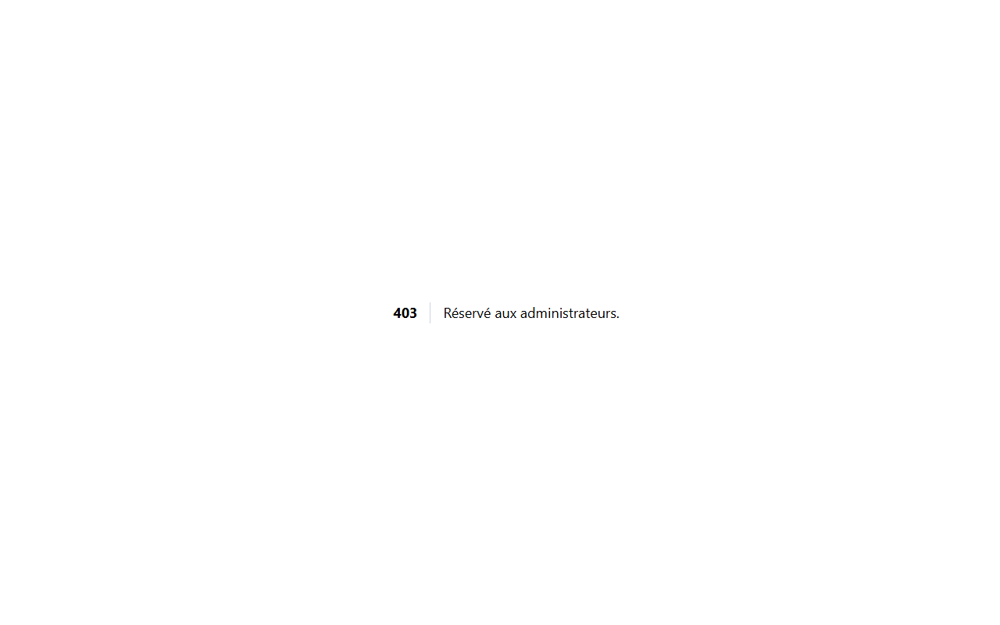
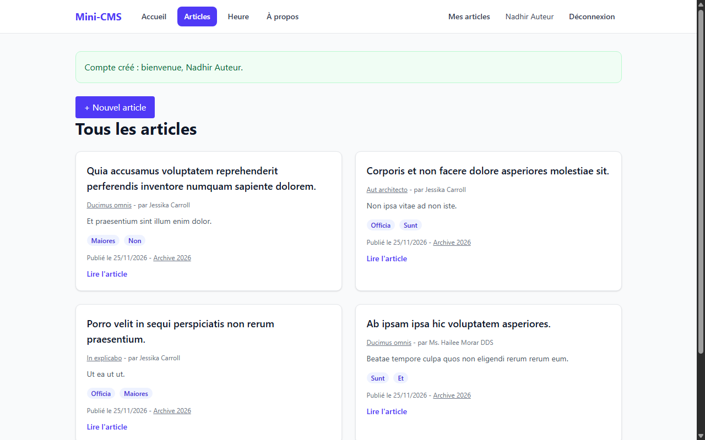

## État actuel (tag lab-06b)

- Middleware `admin` (`App\Http\Middleware\EnsureUserIsAdmin`) sur tout `/admin` : un auteur reçoit 403 « Réservé aux administrateurs. ».
- Gate `manage-tags`, comme `manage-categories` : contrôleur, Form Requests et menu.
- Brouillons protégés : `PostPolicy::view` et le scope `visibleTo` ; un brouillon n'est visible que par son auteur et les administrateurs.
- Gestion des rôles (`/admin/utilisateurs`) et `Gate::before` pour les administrateurs (sans contourner l'interdiction de modifier son propre rôle).
- Tests d'autorisation : `AdminAccessTest` (7 tests), `PostVisibilityTest` (5 tests) et `UserRoleTest` (2 tests), en plus des fichiers de la session 11.
- Comparaison écrite avec le starter kit Livewire (section ci-dessous).

## Routes disponibles

| Méthode | URI | Nom | Action |
|---|---|---|---|
| GET | `/` | `home` | `PageController@home` |
| GET | `/a-propos` | `about` | `PageController@about` |
| GET | `/heure` | `time` | `PageController@time` |
| GET | `/posts` | `posts.index` | `PostController@index` |
| GET | `/posts/archive/{year}` | `posts.archive` | `PostController@archive` |
| GET | `/posts/categorie/{category:slug}` | `posts.category` | `PostController@byCategory` |
| GET | `/posts/tag/{tag:slug}` | `posts.tag` | `PostController@byTag` |
| GET | `/inscription` | `register` | `RegisterController@create` |
| POST | `/inscription` | `register.store` | `RegisterController@store` |
| GET | `/connexion` | `login` | `LoginController@create` |
| POST | `/connexion` | `login.store` | `LoginController@store` |
| POST | `/deconnexion` | `logout` | `LoginController@destroy` |
| GET | `/mes-articles` | `my-posts` | `PostController@myPosts` |
| GET | `/posts/create` | `posts.create` | `PostController@create` |
| POST | `/posts` | `posts.store` | `PostController@store` |
| GET | `/posts/{post}` | `posts.show` | `PostController@show` |
| GET | `/posts/{post}/edit` | `posts.edit` | `PostController@edit` |
| PUT | `/posts/{post}` | `posts.update` | `PostController@update` |
| DELETE | `/posts/{post}` | `posts.destroy` | `PostController@destroy` |
| PATCH | `/posts/{post}/publication` | `posts.publication` | `PostController@togglePublication` |
| GET | `/admin/categories` | `admin.categories.index` | `CategoryController@index` |
| GET | `/admin/categories/create` | `admin.categories.create` | `CategoryController@create` |
| POST | `/admin/categories` | `admin.categories.store` | `CategoryController@store` |
| GET | `/admin/categories/{category}/edit` | `admin.categories.edit` | `CategoryController@edit` |
| PUT | `/admin/categories/{category}` | `admin.categories.update` | `CategoryController@update` |
| DELETE | `/admin/categories/{category}` | `admin.categories.destroy` | `CategoryController@destroy` |
| GET | `/admin/tags` | `admin.tags.index` | `TagController@index` |
| GET | `/admin/tags/create` | `admin.tags.create` | `TagController@create` |
| POST | `/admin/tags` | `admin.tags.store` | `TagController@store` |
| GET | `/admin/tags/{tag}/edit` | `admin.tags.edit` | `TagController@edit` |
| PUT | `/admin/tags/{tag}` | `admin.tags.update` | `TagController@update` |
| DELETE | `/admin/tags/{tag}` | `admin.tags.destroy` | `TagController@destroy` |
| GET | `/admin/utilisateurs` | `admin.users.index` | `UserController@index` |
| PATCH | `/admin/utilisateurs/{user}/role` | `admin.users.role` | `UserController@updateRole` |

### Session 08

### Session 09

### Session 10

### Session 11

### Session 12

## Comparaison avec le starter kit Livewire

| Critère | Mini-CMS (authentification manuelle) | Starter kit Livewire |
|---|---|---|
| Routes d'authentification | `routes/web.php` (`/inscription`, `/connexion`, `/deconnexion`) | Enregistrées par Fortify depuis son paquet ; absentes de `routes/web.php` |
| Inscription | `app/Http/Controllers/Auth/RegisterController.php` et `resources/views/auth/register.blade.php` | `app/Actions/Fortify/CreateNewUser.php` (`Validator::make`, `User::create`) et `resources/views/pages/auth/register.blade.php` |
| Connexion | `app/Http/Controllers/Auth/LoginController.php` (`Auth::attempt`, `regenerate()`) et `resources/views/auth/login.blade.php` | Contrôleur de Fortify et `resources/views/pages/auth/login.blade.php` |
| Déconnexion | `app/Http/Controllers/Auth/LoginController.php` (`destroy` : `logout`, `invalidate`, `regenerateToken`) | Route `logout` de Fortify et `app/Livewire/Actions/Logout.php` |
| Limitation des tentatives | Aucune | 5 tentatives par minute par e-mail et adresse IP (`app/Providers/FortifyServiceProvider.php`) |
| Mot de passe oublié | Absent | `Features::resetPasswords()` dans `config/fortify.php` |
| Vérification de l'e-mail | Absente | `Features::emailVerification()`, `MustVerifyEmail` sur `User`, middleware `verified` sur `/dashboard` |
| Double authentification | Absente | `Features::twoFactorAuthentication()` et `Features::passkeys()` |
| Rôles et autorisations | Colonne `role`, `EnsureUserIsAdmin`, Gates (`manage-categories`, `manage-tags`), `PostPolicy` | Aucun : à écrire soi-même (rôles, Gates, Policies, middleware) |
| Tests | `AuthTest`, `AuthorizationTest`, `AdminAccessTest`, `PostVisibilityTest` (Pest) | 10 fichiers dans `tests/Feature` (`Auth`, `Settings`, `Dashboard`) |

Ce que je garderais du kit dans un vrai projet : je conserverais la limitation des tentatives de connexion, la réinitialisation du mot de passe, la vérification d'e-mail et la double authentification déjà sécurisées par Fortify. En revanche, j'écrirais toujours moi-même les rôles, les middlewares, les Gates et les Policies, car aucun starter kit ne connaît les règles métier d'autorisation de l'application.