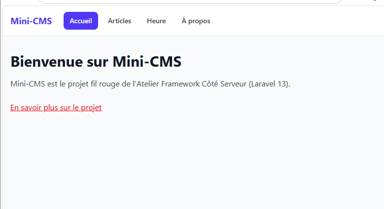
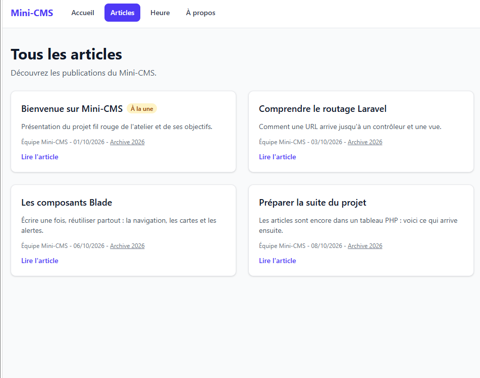
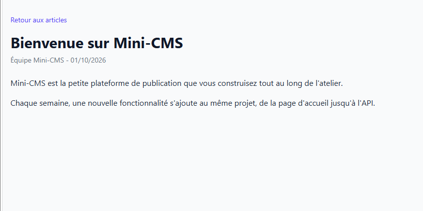
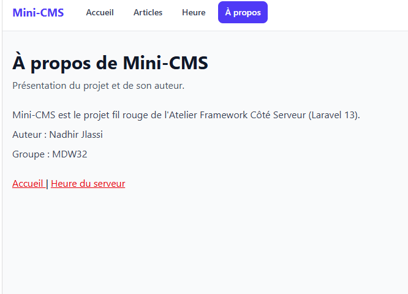
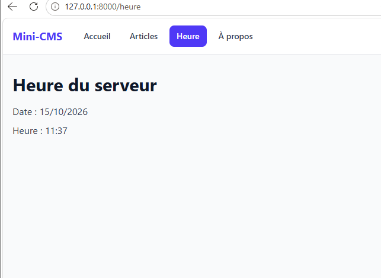

# Mini-CMS — Atelier Framework Côté Serveur

Projet Laravel réalisé dans le cadre de l'Atelier Framework Côté Serveur à l'ISET Sidi Bouzid.

## État actuel — Session 04

- Routes nommées pour les pages et les articles.
- Contrôleurs PageController et PostController.
- Articles stockés dans un tableau PHP, sans base de données pour l'instant.
- Layout Blade réutilisable avec Tailwind CSS et Vite.
- Composants Blade : navbar, nav-link, post-card, alert et page-header.
- Pages d'accueil, À propos, Heure du serveur, liste des articles, détail et archives.
- Navigation basée sur les noms des routes.
- Utilisation des propriétés et des slots dans les composants Blade.

## Routes disponibles

| Méthode | URI | Nom | Action |
|---|---|---|---|
| GET | `/` | `home` | `PageController@home` |
| GET | `/a-propos` | `about` | `PageController@about` |
| GET | `/heure` | `time` | `PageController@time` |
| GET | `/posts` | `posts.index` | `PostController@index` |
| GET | `/posts/archive/{year}` | `posts.archive` | `PostController@archive` |
| GET | `/posts/{slug}` | `posts.show` | `PostController@show` |

## Composants Blade

- `x-layout` : structure commune des pages.
- `x-navbar` : barre de navigation.
- `x-nav-link` : lien de navigation avec état actif.
- `x-post-card` : carte d'un article.
- `x-alert` : message avec différents styles.
- `x-page-header` : titre et sous-titre réutilisables.

## Captures d'écran — Session 04

### 1. Page d'accueil

### 2. Liste des articles

### 3. Détail d'un article

### 4. Page À propos

### 5. Heure du serveur
